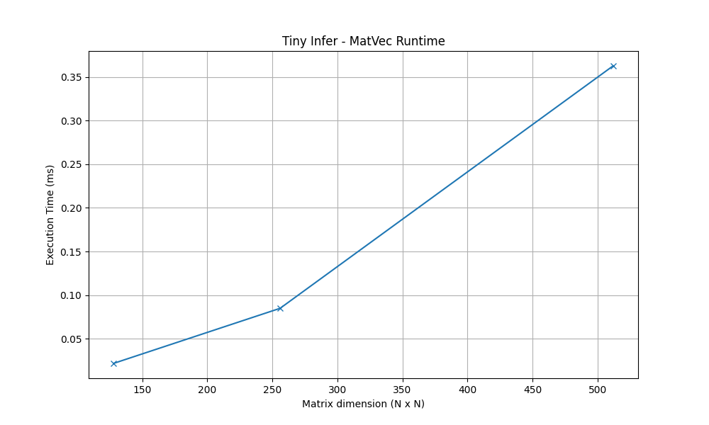

# Tiny Infer: From-Scratch C++ Inference Engine

A from-scratch C++17 learning project exploring the building blocks of AI inference: tensor storage, numerical operations, data serialization, correctness checks, and command-line tooling. The longer-term goal is to understand, benchmark, and optimize the systems behind AI workloads.

> **Status:** Weeks 1–5 completed (Days 1–35). Tiny Infer is currently a CPU-based C++ learning project featuring tensor operations, automated correctness tests, and basic performance benchmarking. It is not yet a production inference engine.

## Project Goal

Learn modern C++by building a small inference-oriented system incrementally, rather than completing unrelated exercises. Each step connects C++ fundamentals to real concerns in numerical computing, including memory layout, validation, performance, and reproducibility.

**Implemented so far**

- C++17 fundamentals, CMake, separate headers and source files, namespaces, exceptions, and RAII concepts.
- A 2D `tinyinfer::Tensor` backed by contiguous `std::vector<float>` storage.
- Mutable and read-only element access, bounds checking, filling, random initialization, and text serialization.
- Naive matrix-vector multiplication (`matvec_naive`) with a row dot-product helper (`dot_product_row`).
- Approximate floating-point comparison (`almost_equal`) and manually checked MatVec cases.
- A `matvec` command-line interface with dimension parsing and validation.
- Five Catch2 unit test cases for Tensor and MatVec operations, integrated with CTest.
- C++ MatVec benchmarking using `std::chrono::steady_clock`.
- Python benchmark automation with CSV output.
- Performance visualization using Matplotlib.

**Planned later:** INT8 quantization, model formats such as GGUF, more performance optimizations, and optional Python bindings. These are roadmap items, **not current features**.

## Quick Start

### Prerequisites

- A C++17-compatible compiler (for example, MSVC, GCC, or Clang).
- CMake **3.30 or newer**, matching the current `CMakeLists.txt` minimum.

From the repository root, configure and build:

```powershell
cmake -S . -B build
cmake --build build --config Debug
```

On Windows with the Visual Studio CMake generator, run:

```powershell
.\build\Debug\tinyinfer.exe matvec --rows 2 --cols 3
```

With a single-configuration generator on Linux or macOS, the executable may instead be at `./build/tinyinfer`:

```bash
./build/tinyinfer matvec --rows 2 --cols 3
```

The `build/` directory contains generated build files and compiled artifacts; it is excluded from Git.

### CLI Usage

```text
tinyinfer matvec --rows <R> --cols <C>
```

- `--rows`: positive number of matrix rows (R).
- `--cols`: positive number of matrix columns (C).
- Both flags are required, with no duplicates. Invalid flags, non-integer values, and non-positive dimensions are rejected.
- The current learning CLI limits each dimension to **4096** to avoid unreasonable allocations.
- A random `R × C` matrix and a random vector of length `C` are generated using values between `-1.0` and `1.0`.
- The result contains `R` elements. Random output values vary between runs.

Example:

```powershell
.\build\Debug\tinyinfer.exe matvec --rows 2 --cols 3
```

The current program prints a few informational labels as well as the summary. The output has this structure:

```text
Generated random vector: 3
Generated random matrix: 2 x 3

MatVec multipication:
Output size: 2
First output value: <random value>

Elapsed time: <measured time> ms
```

`MatVec multipication` is the current console label; it can be renamed in a later cleanup. The `<random value>` placeholder is not literal program output.

Invalid example:

```powershell
.\build\Debug\tinyinfer.exe matvec --rows -2 --cols 3
```

```text
Error: Rows and columns must be positive
```

## Project Layout

```text
tiny-infer-cpp/
├── CMakeLists.txt
├── README.md
├── .gitignore
├── include/
│   └── tinyinfer/
│       ├── memory.hpp
│       ├── file_io.hpp
│       ├── vector_utils.hpp
│       ├── tensor.hpp
│       ├── tensor_io.hpp
│       ├── matvec.hpp
│       └── benchmark.hpp
├── src/
│   ├── main.cpp
│   ├── memory.cpp
│   ├── file_io.cpp
│   ├── vector_utils.cpp
│   ├── tensor.cpp
│   ├── tensor_io.cpp
│   └── matvec.cpp
├── tests/
│   ├── test_tensor.cpp
│   └── test_matvec.cpp
├── benchmarks/
│   ├── matvec_bench.cpp
│   ├── run_matvec_bench.py
│   ├── plot_matvec_bench.py
│   ├── results/
│   │   └── matvec_results.csv
│   └── charts/
│       └── matvec_runtime.png
├── notes/
│   ├── week01_cpp_basics.md
│   ├── week02_cmake_project_structure.md
│   ├── week03_tensor_class.md
│   └── week04_matrix_vector_multiplication.md
└── data/
    ├── vector.txt
    └── tensor.txt
```

**Directory purpose:** `include/tinyinfer/` contains public declarations; `src/` contains implementations and the CLI; `notes/` contains learning logs; `data/` holds sample text files for file I/O and serialization practice.

## Tensor Representation

`tinyinfer::Tensor` represents a two-dimensional matrix with `rows_`, `cols_`, and a private `std::vector<float> data_`. Data is stored **contiguously in row-major order**: elements of row 0 appear before elements of row 1, and so on.

For a row index `r`, column index `c`, and total column count `C`, the corresponding one-dimensional index is:

```text
index = r * C + c
```

The class supports dimension getters, `at(row, col)` (mutable and read-only), bounds checking, `fill(value)`, `print()`, and mutable/const `raw_data()` access. `random_tensor()`, `random_vector()`, `save_tensor_text()`, and `load_tensor_text()` provide basic generation and text I/O.

## Matrix-Vector Multiplication (MatVec)

An `R × C` matrix multiplied by a vector of length `C` produces a vector of length `R`:

```text
output[row] = sum over col (matrix.at(row, col) * vector[col])
```

- `matvec_naive(const Tensor&, const std::vector<float>&)` checks that the input vector length equals the matrix column count, loops over the matrix rows, and builds the output vector.
- `dot_product_row(const Tensor&, long long, const std::vector<float>&)` computes the dot product for one matrix row.
- The implementation is intentionally simple and CPU-based, before future optimized kernels are introduced.

**Complexity:** `O(R × C)` time, because every matrix element participates in one multiply-and-add; `O(R)` additional output storage, excluding the matrix and input vector.

### Correctness Example

```text
Matrix (2 × 3)       Vector (3)      Result (2)
[1  2  3]            [10]            [140]
[4  5  6]      ×     [20]      =     [320]
                      [30]
```

The first row produces `1×10 + 2×20 + 3×30 = 140`; the second produces `4×10 + 5×20 + 6×30 = 320`.

During Week 4, manual `assert()` checks were used for the normal 2×3 case, a 1×1 matrix, a zero matrix, an identity matrix, and a dimension mismatch that must throw an exception. They were later updated to use `almost_equal()` for numeric results.

`almost_equal(a, b, eps)` uses an absolute tolerance (default `1e-5`) to compare floating-point values:

```text
abs(a - b) <= eps
```

This is useful because mathematically equivalent numerical implementations may differ slightly due to floating-point rounding. Absolute tolerance is a first step; later work can add relative tolerance for differently scaled values.

**Testing status:** Tiny Infer includes five automated Catch2 unit test cases covering Tensor and MatVec functionality. These tests are integrated with CTest and can be executed through the `tinyinfer_tests` target.

## Automated Testing — Catch2 and CTest

Tiny Infer uses Catch2 v3.8.1 for C++ unit testing and CTest for running the test suite.

Catch2 is integrated into the CMake project using `FetchContent`.

### Current Test Coverage

Five unit test cases are implemented:

| Test | Description |
|---|---|
| Tensor Shape | Verifies tensor dimensions and element count |
| Tensor Indexing | Verifies correct element access and assignment |
| Tensor Bounds | Checks that out-of-range indexing throws an exception |
| MatVec Correctness | Validates multiplication against known results |
| Dimension Mismatch | Checks that incompatible dimensions throw an exception |

### Build the Project

From the project root:

```powershell
cmake -S . -B build
cmake --build build --config Release
```

CMake 3.30 or newer is required. The initial configuration also needs Git and internet access to download Catch2.

### Run Unit Tests

Using CTest:

```powershell
ctest --test-dir build -C Release --output-on-failure
```

Alternatively, run the Catch2 executable directly:

```powershell
.\build\Release\tinyinfer_tests.exe
```

CTest registers one test named `tinyinfer_unit_tests`, which invokes the Catch2 test executable. Therefore, CTest may report one passing test while Catch2 executes five individual test cases.

These tests validate correctness. They do not measure performance.

---

## MatVec Performance Benchmarking

Tiny Infer includes a simple C++ benchmark for measuring matrix-vector multiplication performance.

The benchmark uses `std::chrono::steady_clock` to measure elapsed execution time in milliseconds.

Random matrix and vector generation happen before the timed region, so the reported time measures the MatVec operation rather than input generation.

### Run a Manual Benchmark

First build the Release configuration:

```powershell
cmake --build build --config Release
```

Then execute:

```powershell
.\build\Release\tinyinfer.exe matvec --rows 512 --cols 512
```

The CLI prints the generated dimensions, output information, and a timing line similar to:

```text
Elapsed time: 0.3627 ms
```

Actual timings vary between executions.

### Automated Benchmarking with Python

The Python benchmark runner executes the Windows Release binary for three square matrix dimensions:

- 128 × 128
- 256 × 256
- 512 × 512

Run:

```powershell
python benchmarks/run_matvec_bench.py
```

The script:

1. Locates the compiled C++ executable.
2. Executes the MatVec benchmark for each matrix size.
3. Captures the program's output using `subprocess.run()`.
4. Extracts and validates the execution time.
5. Saves the measurements to a CSV file.

Results are written to:

```text
benchmarks/results/matvec_results.csv
```

The CSV contains:

```csv
rows,cols,time_ms
128,128,0.0218
256,256,0.0849
512,512,0.3627
```

The current benchmark runner performs one measurement per matrix size. These results are preliminary measurements rather than statistically reliable performance comparisons.

### Performance Visualization with Matplotlib

Install Matplotlib:

```powershell
python -m pip install matplotlib
```

Run the plotting script:

```powershell
python benchmarks/plot_matvec_bench.py
```

The script reads the benchmark CSV, plots matrix dimensions against execution time, and saves a PNG chart.

### Recorded Benchmark Results

The following results were recorded from a local Release benchmark run.

| Matrix dimensions | Execution time (ms) |
|---|---:|
| 128 × 128 | 0.0218 |
| 256 × 256 | 0.0849 |
| 512 × 512 | 0.3627 |

### MatVec Performance Chart



The graph visualizes how execution time changes as matrix dimensions increase.

### Performance Interpretation

Naive matrix-vector multiplication for an R × C matrix has time complexity O(R × C).

For square matrices of dimension N × N, this becomes O(N²).

Doubling both matrix dimensions approximately quadruples the number of multiply-add operations.

However, execution time does not always scale exactly with theoretical operation count because of hardware and system effects.

### Benchmarking Limitations

Several factors can influence benchmark measurements:

- CPU frequency scaling and thermal throttling.
- Operating-system scheduling.
- Background applications consuming CPU or memory bandwidth.
- Cache behavior and memory access patterns.
- Compiler optimization settings.
- Small measurement samples.

A single measurement is insufficient to establish whether one implementation consistently outperforms another.

Future benchmarks should incorporate repeated measurements, warmup runs where appropriate, and summary statistics such as median runtime.

Release builds should generally be used for performance comparisons because Debug builds often disable important compiler optimizations.

## Learning Approach

Each study day involves reading C++ concepts, implementing a focused task, checking the result, documenting lessons learned, and committing progress to GitHub. The intent is to understand the system and why the code works, not just finish a checklist.

## Week 1 Progress

### Day 01 - Setup and First Compile

- Learned how C++ source code is compiled
- Understood source code, compiler, executable, and `main()`
- Wrote and compiled the first C++ program manually

### Day 02 - Variables, Types, and Input/Output

- Learned fundamental data types
- Practiced `std::cin` and `std::cout`
- Built a tensor memory estimator for FP32 and INT8

### Day 03 - Functions and Clean Code

- Learned functions, parameters, arguments, and return values
- Practiced pass-by-value and pass-by-reference
- Refactored the tensor memory estimator into separate functions

### Day 04 - Loops and Vectors

- Learned `for` and `while` loops
- Learned `std::vector`
- Implemented vector creation, summation, and maximum absolute value calculations

### Day 05 - Structs and Data Modeling

- Learned how structs group related data
- Created a `TensorShape` struct
- Added shape validation and element-count calculations

### Day 06 - File I/O

- Learned `std::ifstream` and `std::ofstream`
- Saved vector data to a text file
- Loaded vector data back from disk

### Day 07 - Week 1 Review

- Reviewed C++ fundamentals from Week 1
- Documented lessons learned
- Prepared the project for Week 2

## Week 2 Progress

### Day 08 - CMake Basics

- Learned why CMake is used in C++ projects
- Created the first `CMakeLists.txt`
- Learned the difference between configuring and building
- Added the `tinyinfer` executable target
- Set the C++ standard for the project

### Day 09 - Header and Source Separation

- Learned the difference between declarations and definitions
- Split reusable functions into `.hpp` and `.cpp` files
- Created the `include/tinyinfer/` project structure
- Learned how separate compilation and linking work
- Configured CMake include directories

### Day 10 - Namespaces

- Learned why namespaces prevent naming conflicts
- Added the `tinyinfer` namespace
- Learned the `::` scope resolution operator
- Started using explicit namespace-qualified names such as `tinyinfer::num_elements`

### Day 11 - Error Handling

- Learned `std::runtime_error`
- Learned `throw`, `try`, and `catch`
- Added validation for invalid tensor dimensions
- Added missing-file error handling
- Added empty-vector error handling
- Learned how low-level functions can throw errors for higher-level callers to handle

### Day 12 - References and Pointers

- Compared pass-by-value and pass-by-reference
- Learned that references act as aliases for existing objects
- Learned that pointers store memory addresses
- Practiced the address-of and dereference operators
- Learned how `nullptr` represents a pointer that points to no object

### Day 13 - RAII and Memory Safety

- Learned the basic idea of RAII
- Learned what memory leaks and dangling pointers are
- Learned why manual `new` and `delete` can introduce memory-management problems
- Decided to avoid raw dynamic arrays in the early Tiny Infer implementation
- Chose `std::vector<float>` for Tensor storage

### Day 14 - Week 2 Review and Cleanup

- Reviewed Week 2 C++ concepts
- Cleaned the repository structure
- Verified headers and implementations are separated correctly
- Reviewed CMake configuration
- Documented build instructions and project layout
- Prepared the repository for the Tensor implementation

## What I Learned About CMake

CMake is a build-system generator rather than a compiler.

`CMakeLists.txt` describes how the project should be built, including its source files, executable targets, C++ standard, and include directories.

The main commands currently used are:

```bash

cmake -S . -B build

```

This configures the project and generates the build system inside the `build/` directory.

```bash

cmake --build build

```

This uses the generated build system to compile the source files and link them into the final executable.

As the project grows, CMake allows new source files and components to be added without manually writing compiler commands for the entire project.

## Week 3 Progress

### Day 15 - Classes and Tensor Skeleton

- Learned how C++ classes group data and behavior
- Learned the difference between `public` and `private` members
- Learned how constructors initialize objects
- Created the first `tinyinfer::Tensor` class
- Added private `rows_`, `cols_`, and `data_` members
- Added `rows()`, `cols()`, and `size()` getters
- Added constructor validation for invalid tensor dimensions
- Used `std::vector<float>` as the Tensor's underlying storage

### Day 16 - Tensor Indexing and Row-Major Storage

- Learned how row-major storage represents 2D data inside a 1D contiguous buffer
- Used the indexing formula `row * cols_ + col`
- Added mutable `at(row, col)` access using `float&`
- Added a const `at(row, col)` overload for read-only access
- Added Tensor printing using nested row and column loops
- Learned how member functions operate directly on the object they belong to

### Day 17 - Bounds Checking and Exceptions

- Added bounds checking to Tensor indexing
- Learned when `(row, col)` coordinates are outside valid Tensor dimensions
- Used `std::out_of_range` for invalid Tensor access
- Prevented invalid indexing before accessing `data_`
- Used `std::exception` in `main()` to handle multiple standard exception types

### Day 18 - Tensor Utility Methods

- Added `fill(float value)` to initialize all Tensor elements with one value
- Added mutable `raw_data()` access to the underlying vector
- Added const `raw_data()` access for read-only use
- Reinforced the difference between copying a vector and referencing its original storage
- Calculated a Tensor sum using the underlying contiguous data buffer

### Day 19 - Random Tensor Generation

- Learned the role of random seeds
- Learned how `std::mt19937` works as a pseudo-random number generator engine
- Learned how `std::uniform_real_distribution<float>` generates values within a range
- Added `random_vector()` for creating random input vectors
- Added `random_tensor()` for creating new randomly initialized Tensors
- Used `raw_data()` to populate Tensor storage directly
- Learned why reproducible random seeds will matter later for benchmarking

### Day 20 - Tensor Text Serialization

- Learned serialization and deserialization
- Added `save_tensor_text()` to write Tensor dimensions and values to a text file
- Added `load_tensor_text()` to reconstruct a Tensor from a text file
- Stored Tensor values in row-major order
- Used const references when saving to avoid unnecessary copies
- Used mutable references when loading to modify the Tensor's actual storage
- Added `tensor_io.hpp` and `tensor_io.cpp`
- Connected Tensor storage with persistent file representation

### Day 21 - Week 3 Review

- Reviewed the complete Tensor implementation
- Reviewed row-major storage and 2D to 1D indexing
- Reviewed why `std::vector<float>` is sufficient for the first Tensor implementation
- Reviewed references, const access, random generation, and serialization
- Identified problem decomposition and program visualization as areas to continue improving
- Prepared the Tensor abstraction for numerical operations in Week 4

## Current Tensor Capabilities

The current `tinyinfer::Tensor` implementation supports:

- dynamic 2D Tensor construction
- dimension validation
- contiguous `std::vector<float>` storage
- row-major indexing
- mutable and read-only element access
- bounds checking
- Tensor printing
- filling all Tensor elements with a value
- direct access to the underlying contiguous buffer
- random Tensor generation
- random vector generation
- text serialization
- text deserialization

Conceptually, the Tensor currently looks like:

```text

Tensor

├── rows_

├── cols_

├── data_

│

├── rows()

├── cols()

├── size()

├── at(row, col)

├── at(row, col) const

├── print()

├── fill(value)

├── raw_data()

└── raw_data() const

```

## Week 4 Progress

### Day 22 - Naive Matrix-Vector Multiplication

- Implemented `matvec_naive()` for an `R × C` matrix and a `C`-element input vector.
- Added dimension compatibility checking and confirmed the 2×3 example produces `[140, 320]`.
- Studied the `O(R × C)` computational cost.

### Day 23 - Manual MatVec Validation

- Added manual `assert()` checks for the normal example, 1×1, zero matrix, and identity matrix.
- Checked that incompatible matrix/vector dimensions raise an exception.

### Day 24 - Dot Product Helper

- Extracted row-wise multiplication and summation into `dot_product_row()`.
- Refactored `matvec_naive()` to call the helper once per row without changing the algorithm.

### Day 25 - Floating-Point Comparison

- Learned why floating-point results can differ slightly due to rounding.
- Added `almost_equal()` with a default absolute tolerance of `1e-5`.
- Used approximate comparison in manual MatVec assertions.

### Day 26 - MatVec CLI

- Added command-line parsing with `argc`, `argv`, and `std::stoll()`.
- Validated the `matvec` command, flags, integer values, and requested dimensions.
- Connected the CLI to random matrix/vector generation and the existing MatVec implementation.

### Day 27 - MatVec and LLM Inference

- Documented the role of matrix-vector multiplication in neural-network linear layers and single-request decoding.
- Compared matrix-vector multiplication (GEMV) with matrix-matrix multiplication (GEMM), including prefill and batched decoding.
- Studied weight storage, memory bandwidth, and reasons to optimize numerical kernels.

### Day 28 - Week 4 Review and Documentation

- Reviewed MatVec mathematics, function decomposition, correctness checks, CLI arguments, and their relationship to inference.
- Updated the README with implemented features, usage examples, and a reproducible correctness example.

## Week 5 Progress

### Day 29 — Catch2 Unit Tests

- Integrated Catch2 using CMake FetchContent.
- Implemented five unit test cases covering Tensor and MatVec functionality.
- Separated automated correctness testing from the main CLI.

### Day 30 — CTest Integration

- Registered the Catch2 test executable with CTest.
- Learned how to build and execute tests using CMake.
- Established a repeatable unit-testing workflow.

### Day 31 — C++ MatVec Benchmark

- Implemented `time_matvec_ms()` using `std::chrono::steady_clock`.
- Measured matrix-vector multiplication separately from input generation.
- Added elapsed-time reporting to the CLI.

### Day 32 — Python Benchmark Automation

- Created a Python benchmark runner using `subprocess.run()`.
- Extracted and validated execution time from C++ output.
- Exported benchmark results to CSV.

### Day 33 — Performance Visualization

- Learned Matplotlib fundamentals.
- Converted CSV measurements into numerical lists.
- Generated a MatVec performance chart.

### Day 34 — Benchmarking Fundamentals

- Studied measurement variability and repeated benchmarking.
- Learned how CPU frequency and background applications affect execution time.
- Compared Debug and Release configurations.
- Analyzed benchmark results to avoid misleading performance conclusions.

### Day 35 — Week 5 Documentation

- Documented the testing and benchmarking workflow.
- Added reproducible build and execution commands.
- Included recorded benchmark measurements and visualization.

## Current Status and Next Steps

**Completed:** Weeks 1–5 covering C++ fundamentals, project structure, Tensor implementation, naive MatVec, automated unit testing, and basic benchmarking.

**Next:** Week 6 — INT8 Quantization.

**Long-term goal:** Build efficient AI inference systems and develop expertise in performance optimization across different AI workloads and hardware platforms.